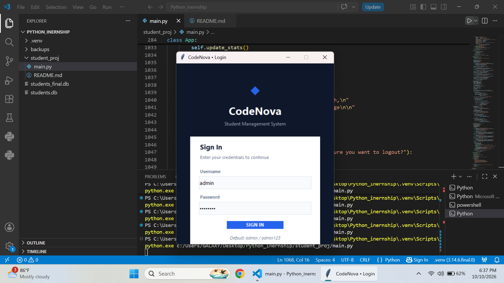
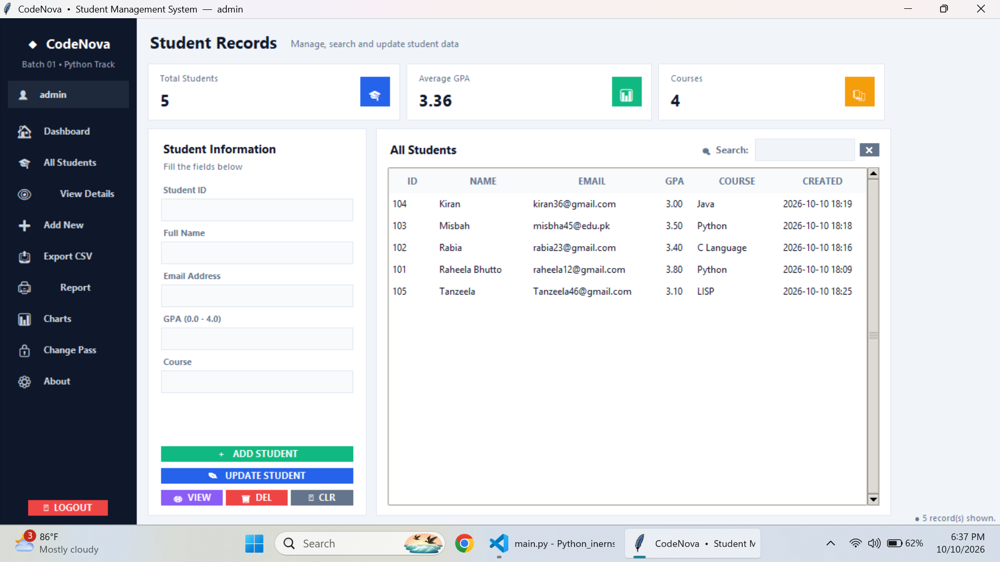
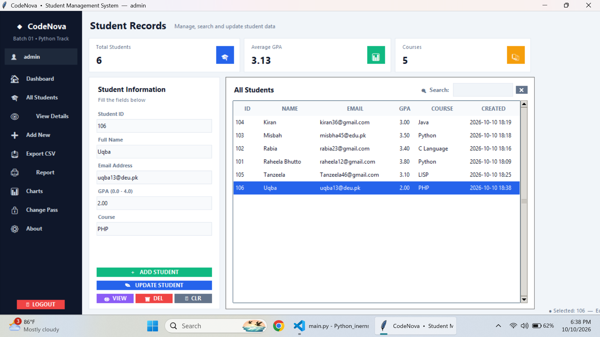
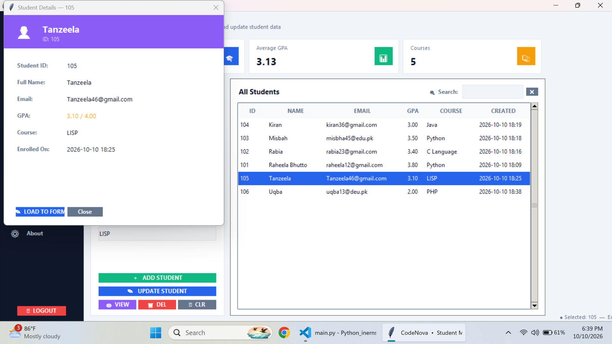
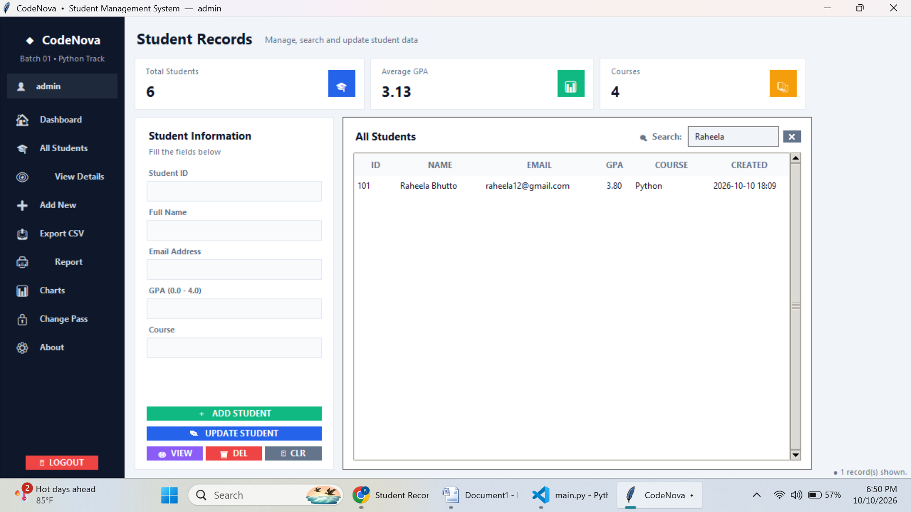
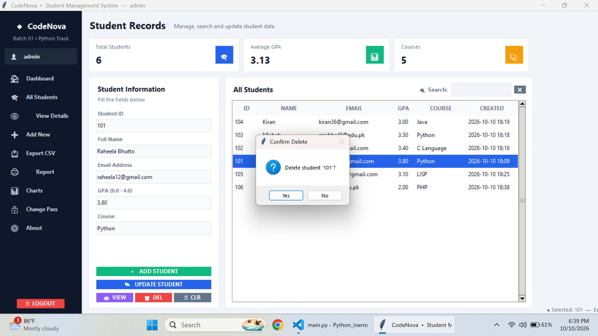
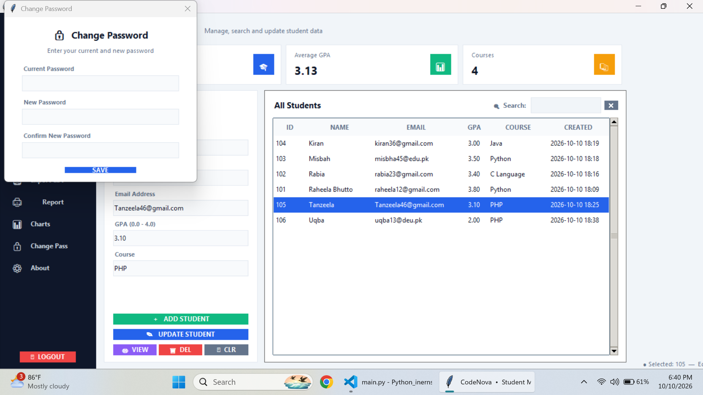
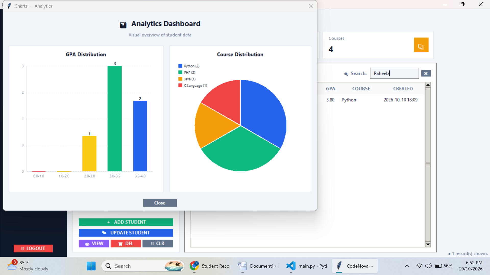
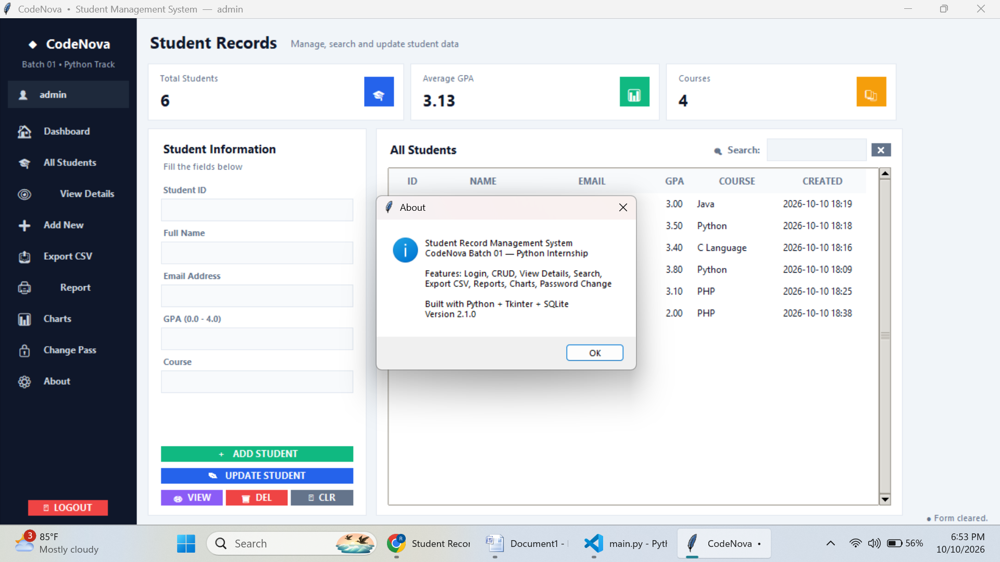

# Student Record Management System

A Python-based GUI application to manage student records. It includes Login, Add, View, Update, Delete, Search, Export, Report, and Charts features.

## How to Run

1. Ensure Python 3.8 or higher is installed.
2. Open Terminal or Command Prompt.
3. Navigate to the project folder.
4. Run the following command:

   python main.py

5. Login using:
   - Username: admin
   - Password: admin123

## Features

- Login system (password protected)
- Add new student
- View all students
- Update student details
- Delete student
- Search by ID, Name, Email, or Course
- View full details of any student
- Export data to CSV file
- Generate text report
- View GPA and Course charts
- Change password

## Tech Stack

- Python 3.x
- Tkinter (GUI)
- SQLite3 (Database)

100% free to use. No paid tools required.

## Files

- main.py         → Main application
- students.db     → Database (auto-created on first run)
- README.md       → This file

## Author

Raheela Bhutto
CodeNova Batch 01 — Python Track

## Screenshots

### 1. Login Screen

### 2. Main Dashboard

### 3. Add Student

### 4. View Details

### 5. Search by ID

### 6. Search by Name

### 7. Delete Student

### 8. Change Password

### 9. Analytics Charts

### 10. About

